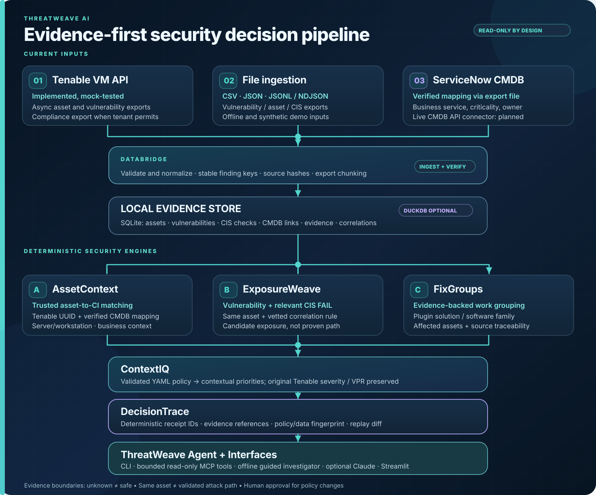

# ThreatWeave AI

[](https://github.com/sreedhar51/threatweave-ai/actions/workflows/tests.yml)


**Which fix should we investigate first, why did that answer change, and can we prove it?**

A vulnerability scanner tells you what is wrong on each host. A CIS audit tells you
which controls failed. The CMDB tells you which hosts matter to the business. Analysts
still stitch those three together by hand, then struggle to explain why yesterday's
top priority is not today's. ThreatWeave is a read-only Claude agent that does the
stitching, ranks candidate fix groups with a deterministic policy engine, and writes a
**Decision Receipt** for every run, so any priority can be traced back to the exact
findings and policy rules that produced it.

> **Validated on the Tenable Partner Lab (read-only, operator-reported):** 1,394 assets,
> 18,974 vulnerability and 4,483 compliance records ingested with zero rejections;
> 2,863 candidate same-asset correlations; and a 5,909-group Decision Receipt
> reproduced byte-for-byte on a second run. See [build status](docs/BUILD_STATUS.md).

**ThreatWeave AI Architecture**  
*Unified Vulnerability and Compliance Prioritization by Correlating Exposure, Compliance, and Business Context*



See [architecture details](docs/ARCHITECTURE.md) and [pitch-deck messaging](docs/PITCH_MESSAGING.md).

## How it works

1. **Gather (read-only).** Import Tenable VM exports, `.nessus` files, Security Center
   analysis results, CIS compliance results, and ServiceNow CMDB exports. Every record
   keeps its source hash. Vendor severity and VPR are stored unchanged.
2. **Correlate.** Pair a vulnerability with a failed CIS check only when both sit on
   the **same Tenable asset UUID** and a vetted `software_family` to `control_id` rule
   links them. A CIS failure next to an unrelated finding is not treated as extra risk.
3. **Add business context.** A CMDB row affects priority only after a human approves
   its mapping to a Tenable asset UUID. A matching hostname or IP is not enough.
4. **Decide.** A restricted, schema-checked YAML policy turns evidence into a ranked
   list of candidate fix groups. This step is fully deterministic: Claude never scores
   or ranks anything.
5. **Explain.** Claude investigates the top groups through read-only tools, cites
   finding IDs, and can draft new policy rules that stay unapproved until a human
   reviews them.
6. **Prove.** Each run produces a Decision Receipt fingerprinting the dataset, the
   policy, and the ranking. Decision Replay compares two receipts and attributes every
   rank change to a policy change, a data change, or both.

## What you get

| Output | What it contains |
|---|---|
| **Ranked candidate fix groups** | Rank, contextual priority, matched rule IDs with their score contributions, affected assets, cited finding IDs, and the original vendor severity and VPR |
| **Decision Receipt** | Dataset fingerprint, policy fingerprint, and the full ranking. The same inputs always produce the same receipt ID |
| **Decision Replay** | Which groups moved, by how much, and whether the cause was policy, data, or both |
| **Investigation brief** | Next human review steps for the top groups, from the offline guided agent or from Claude |
| **OWASP audit** | 20 OWASP LLM and Agentic AI controls, each reported as `TESTED`, `DESIGN`, or `FAIL` |

### Example: the same policy, three evidence stages

`threatweave demo --staged` replays one synthetic payment web server through three
stages under an unchanged policy:

| Stage | "Upgrade OpenSSH package" | Rules that fired | Why |
|---|---|---|---|
| 1. Vulnerabilities only | rank 3, score 55.53 (high) | none | Baseline scanner evidence |
| 2. Plus CIS results | rank 2, score 69.53 (high) | `TW-COMPOUND` | A vetted SSH control failed on the same asset |
| 3. Plus verified CMDB | rank 1, score 93.53 (urgent) | `TW-COMPOUND`, `TW-PAYMENTS` | The asset is a verified payments system |

Each stage writes its own receipt, and the replay shows the source fingerprint
changing (`compliance`, `correlations`, then `cmdb`) while the policy fingerprint stays
fixed. All demo hosts, identifiers, and CIS controls are synthetic.

## Setup and How to Run

Requires Python 3.11 or newer and Git. The demo needs no Tenable account or API key.

**macOS / Linux**

```bash
git clone https://github.com/sreedhar51/threatweave-ai.git
cd threatweave-ai
python3 -m venv .venv
source .venv/bin/activate
python -m pip install -e '.[ui,dev]'
```

**Windows PowerShell**

```powershell
git clone https://github.com/sreedhar51/threatweave-ai.git
cd threatweave-ai
py -3.13 -m venv .venv
.\.venv\Scripts\python.exe -m pip install -e ".[ui,dev]"
```

Replace `py -3.13` with your installed Python version. On Windows, use
`.\.venv\Scripts\python.exe -m threatweave.cli` wherever this README says `threatweave`
if the command is not on your PATH.

Then run the offline demo:

```bash
threatweave --db runtime/demo.db demo            # load synthetic data, rank, write receipts
threatweave --db runtime/demo.db investigate     # offline guided investigation
threatweave compare runtime/receipts/demo-before.json runtime/receipts/demo-after.json
threatweave demo --staged                        # same policy, three evidence stages
threatweave --db runtime/demo.db check-owasp     # OWASP LLM and Agentic AI audit
```

Every command prints JSON. Receipts are written to `runtime/receipts/`.

## Dashboard

```bash
streamlit run dashboard/app.py
```

Open http://localhost:8501. The sidebar switches between three isolated data sources,
so demo data can never be written into a tenant database:

| Mode | Data |
|---|---|
| **Tenant** | Your imported evidence, from the database in `THREATWEAVE_DB` |
| **Synthetic demo** | The bundled demonstration in `runtime/demo.db` |
| **Staged demo** | Vulnerabilities, then CIS evidence, then verified synthetic CMDB context |

The **Fix Groups & Assets**, **Policy & Investigation**, and **Decision Replay** tabs
show candidate fixes with source evidence and vendor scores, contextual policy
decisions with versioned local policy approval, ingestion history, and before/after
rank changes.

## Use it with Claude

ThreatWeave works with Claude in four ways. All of them use the same read-only
evidence tools; none can patch, scan, open tickets, or change anything in Tenable.

### From the command line (Claude API)

```bash
python -m pip install -e '.[agent]'
export ANTHROPIC_API_KEY=...        # never commit this
threatweave --db runtime/demo.db ask "Which fix group should we investigate first, and why?"
threatweave draft-rule "Raise priority for internet-exposed production assets"
```

`ask` runs a bounded tool-use loop and prints a JSON record with the answer, the tools
called, how the run ended (`completed`, `refused`, `truncated`, or `budget_exhausted`),
and any warnings. `draft-rule` returns a schema-checked rule with `approved: false`.
Exit codes: `0` completed, `1` bad input, `2` Claude unavailable, `3` the run did not
complete.

### Dashboard (Claude API)

With `ANTHROPIC_API_KEY` set, the **Policy & Investigation** tab can ask Claude to
investigate bounded evidence or draft a policy rule. Drafts go to the YAML editor as
unapproved proposals.

### Claude Code (agent and MCP server)

The repository ships `.mcp.json`, which registers the MCP server, and
`.claude/agents/threatweave.md`, a subagent that can use only the six ThreatWeave
tools. It cannot read files, run commands, or browse the web.

```bash
python -m pip install -e '.[mcp]'
threatweave --db runtime/demo.db demo     # the MCP server reads this database
claude                                     # open this repository as the project
```

Then ask: *"Use the threatweave agent: which fix group should we investigate first,
and why did it move?"*

### Claude Desktop or any MCP client

```json
{
  "mcpServers": {
    "threatweave": {
      "command": "python",
      "args": ["-m", "threatweave.mcp_server"],
      "env": {
        "THREATWEAVE_DB": "/absolute/path/to/threatweave-ai/runtime/demo.db",
        "THREATWEAVE_POLICY": "/absolute/path/to/threatweave-ai/policies/business-context.yaml"
      }
    }
  }
}
```

| Tool | Purpose |
|---|---|
| `get_security_overview` | Imported assets, findings, compliance results, and context coverage |
| `list_fix_groups` | Ranked candidate fix groups with evidence references |
| `get_asset_exposure` | Same-asset vulnerabilities, CIS failures, and CMDB context for one asset |
| `get_group_evidence` | Bounded source evidence for one fix group |
| `evaluate_policy_dry_run` | Validate and preview a proposed policy without activating it |
| `compare_decision_receipts` | Replay two receipts from the configured receipts directory |

## Configuration

Copy `.env.example` to `.env` (git-ignored) or set the variables in your shell. Every
variable is optional.

| Variable | Used for | Default |
|---|---|---|
| `ANTHROPIC_API_KEY` | Claude features (`ask`, `draft-rule`, dashboard) | none (Claude features off) |
| `THREATWEAVE_CLAUDE_MODEL` | Claude model ID | `claude-opus-5-5` |
| `THREATWEAVE_CLAUDE_EFFORT` | Claude effort level: `low`, `medium`, `high`, `xhigh`, `max` | `high` |
| `THREATWEAVE_CLAUDE_FALLBACKS` | `off` disables automatic fallback when Claude declines a request | on, for models that support it |
| `TENABLE_ACCESS_KEY`, `TENABLE_SECRET_KEY` | Read-only Tenable VM exports | none |
| `TENABLE_BASE_URL` | Tenable VM API base URL | `https://cloud.tenable.com` |
| `SC_ACCESS_KEY`, `SC_SECRET_KEY` | Read-only Security Center analysis | none |
| `THREATWEAVE_DB` | Tenant database (dashboard and MCP server) | `runtime/threatweave.db` |
| `THREATWEAVE_POLICY` | Active policy file (MCP server) | `policies/business-context.yaml` |
| `THREATWEAVE_RECEIPTS` | Directory receipt comparisons may read | `runtime/receipts` |

## Connect real, authorized data

Use **rotated** credentials, entered through a secret manager or a hidden prompt.
Never commit secrets, tenant exports, or SQLite databases.

**Windows PowerShell**

```powershell
$ak = Read-Host "Tenable access key" -AsSecureString
$sk = Read-Host "Tenable secret key" -AsSecureString
$env:TENABLE_ACCESS_KEY = [System.Net.NetworkCredential]::new("", $ak).Password
$env:TENABLE_SECRET_KEY = [System.Net.NetworkCredential]::new("", $sk).Password

$python = ".\.venv\Scripts\python.exe"
& $python -m threatweave.cli --db runtime/tenant-lab.db tenable-export asset
& $python -m threatweave.cli --db runtime/tenant-lab.db tenable-export vulnerability
& $python -m threatweave.cli --db runtime/tenant-lab.db tenable-export compliance
& $python -m threatweave.cli --db runtime/tenant-lab.db correlate
& $python -m threatweave.cli --db runtime/tenant-lab.db receipt --policy policies/business-context.yaml --out runtime/receipts/tenant-lab.json

Remove-Item Env:TENABLE_ACCESS_KEY,Env:TENABLE_SECRET_KEY -ErrorAction SilentlyContinue
```

**Files you already exported (any platform)**

```bash
threatweave --db runtime/local.db import asset assets.json
threatweave --db runtime/local.db import vulnerability vulns.jsonl
threatweave --db runtime/local.db import compliance compliance.csv
threatweave --db runtime/local.db import nessus scan.nessus
threatweave --db runtime/local.db cmdb-propose servicenow.csv --out mappings.csv
# Review mappings.csv and set mapping_verified=yes only on rows you have confirmed
threatweave --db runtime/local.db import cmdb mappings.csv --provider servicenow-export
threatweave --db runtime/local.db correlate
```

Scope exports deliberately: without filters, Tenable may export everything in its
default scope. Pass documented filters with `--body-file`. Before a live run,
`python scripts/tenant_preflight.py` checks read access and coverage without printing
hostnames, IPs, plugin output, or credentials. See [Connectors](docs/CONNECTORS.md),
[Tenant preflight](docs/TENANT_PREFLIGHT.md), and [On-prem Security Center](docs/ON_PREM.md).

## Security model

- **Read-only by construction.** No tool writes to Tenable, Security Center, ServiceNow,
  or any other system. There are no patch, scan, ticket, or remediation tools.
- **Claude explains; the engine decides.** Scores come only from the deterministic
  policy engine. Claude-drafted rules are proposals with `approved: false`.
- **Untrusted evidence.** Scanner and CMDB text is scrubbed of credentials and wrapped
  as non-executable data before Claude sees it. If evidence contains text that looks
  like a prompt-injection attempt, the result is marked `injection_flagged` and the
  answer carries a warning for the reviewer.
- **Bounded agent.** At most 5 tool-use turns and 5 tools per turn, with strict tool
  schemas and input validation. Tool results are capped at 16,000 characters and
  return a valid `TRUNCATED` marker instead of partial evidence.
- **Conservative claims.** No cross-host attack paths, no unknown-as-safe, no identity
  joins on IP addresses.

Details: [OWASP controls](docs/OWASP_AGENT_BEST_PRACTICES.md),
[Architecture and trust boundaries](docs/ARCHITECTURE.md), [Security policy](docs/SECURITY.md).

### Outbound network calls

ThreatWeave makes no network calls unless you configure one of these:

| Destination | When | What is sent |
|---|---|---|
| `cloud.tenable.com` (or `TENABLE_BASE_URL`) | `tenable-export`, `tenant_preflight.py` | Read-only export and status requests |
| Your Security Center URL | `securitycenter-export` | Read-only analysis queries |
| `api.anthropic.com` | `ask`, `draft-rule`, or the dashboard's Claude buttons, with `ANTHROPIC_API_KEY` set | Your question plus bounded tool results: hostnames, finding excerpts, and CMDB context, with credentials scrubbed |

Setting `ANTHROPIC_API_KEY` is the opt-in for sending evidence to Claude. The offline
demo, `investigate`, the MCP server itself, and `check-owasp` send nothing off the
machine. (An MCP client such as Claude Code sends tool results to its own model
provider.)

## Verify it yourself

```bash
python -m pytest -q                          # unit, safety, and mocked-Claude tests
python scripts/ship_check.py --repeat 3      # three clean runs must produce identical receipts
threatweave --db runtime/demo.db check-owasp # exits 1 if any TESTED control fails
python scripts/bench.py --assets 50000       # synthetic ingest and ranking timings
```

`ship_check` builds three independent databases, runs the full three-stage workflow in
each, and fails if any ranking, receipt ID, or source fingerprint differs. CI runs the
tests and the ship check on Python 3.11 and 3.12. On synthetic data, the benchmark
ingested 50,000 assets in 4.7 seconds and ranked them in 1.5 seconds on one machine;
that is not a production throughput claim. See the
[SWARM readiness gate](docs/SWARM_READINESS.md).

## Repository layout

| Path | Responsibility |
|---|---|
| `src/threatweave/ingest.py`, `nessus.py` | CSV, JSON, JSONL, and `.nessus` normalization; identity and CMDB mapping checks |
| `src/threatweave/tenable.py`, `securitycenter.py` | Read-only Tenable VM export and Security Center connectors |
| `src/threatweave/correlate.py` | Vetted same-asset vulnerability-to-CIS correlation |
| `src/threatweave/policy.py` | Restricted, schema-checked policy evaluator |
| `src/threatweave/engine.py` | Fix groups, Decision Receipts, and Decision Replay |
| `src/threatweave/agent.py` | Claude tool-use loop, rule drafting, and the offline guided agent |
| `src/threatweave/mcp_server.py` | Read-only MCP tool surface |
| `src/threatweave/owasp_guardrails.py` | Secret scrubbing, prompt sanitizing, tool allowlist, OWASP audit |
| `.claude/agents/threatweave.md`, `.mcp.json` | Claude Code subagent and MCP registration |
| `dashboard/app.py`, `src/threatweave/ui_workflows.py` | Streamlit dashboard and its workflows |
| `policies/` | Sample policies and vetted correlation rules |
| `examples/` | Synthetic inputs, sample receipts, and an HTML demo report |
| `scripts/` | Ship check, tenant preflight, and benchmark |

## Limitations

- **Candidates, not validated fixes.** Fix groups come from normalized plugin solutions
  and software families. Confirm applicability before scheduling work.
- **Live validation is partial.** Tenable VM ingestion was validated on the Partner Lab
  by the operator. Security Center is tested against mocked API responses only.
  ServiceNow is supported through exports, not a live API connector.
- **Claude clients not yet smoke-tested.** The MCP server is verified end to end with
  MCP Python SDK 2.3.0 over stdio, and the Claude API path is verified through the
  Anthropic SDK with mocked responses. The Claude Code subagent and Claude Desktop setup
  have not yet been exercised in those clients.
- **Synthetic correlation rules.** The sample `software_family` to `control_id` rules
  illustrate the method and are not production-approved mappings.
- **Score ties.** A fix group's score is capped at 100, so large estates produce ties.
  Ties break deterministically on compounded, critical, and production asset counts.
- **No measured time savings.** No hours-saved or risk-reduced figure is claimed until
  it is measured on a real analyst workflow.

## License

MIT. See [LICENSE](LICENSE). Use only data you are authorized to access, and never
commit tenant exports, credentials, or licensed CIS benchmark content.
